# FieldBest laser power meter

Notes, tools and test data for the **FieldBest II** laser power meter, a low-cost
thermal power meter (18 mm aperture, up to about 50 W) that is sold under several
shop names. There is very little to read about it beyond a short manual. This repo
collects what was found out by actually using it: the USB protocol, a logger, and
a series of measurements that check how far its readings can be trusted, including
with nanosecond-pulsed lasers.

## In short

- It is a **plain USB serial device**. Send `?pw%` and you get the power in watts back.
  No vendor software or driver is needed.
- The manual calls the head "pyroelectric", but it is a **thermopile disc**
  (see [Inside](#inside)). It reads CW lasers correctly, takes about 10 s to settle,
  and reports average power.
- **Linear from tens of mW to more than 10 W.** Checked with two hand-held lasers, a
  20 W diode laser and a 20 W fiber laser.
- **Fine with ns pulses.** Q-switched pulses of up to 354 µJ at 30 kHz gave
  stable, linear readings, within 1 % during a step.
- It is not calibrated for every wavelength, so treat absolute values as roughly
  ±10 %. Relative measurements such as steps, trends and before/after comparisons
  are very repeatable.

## The device

<p>
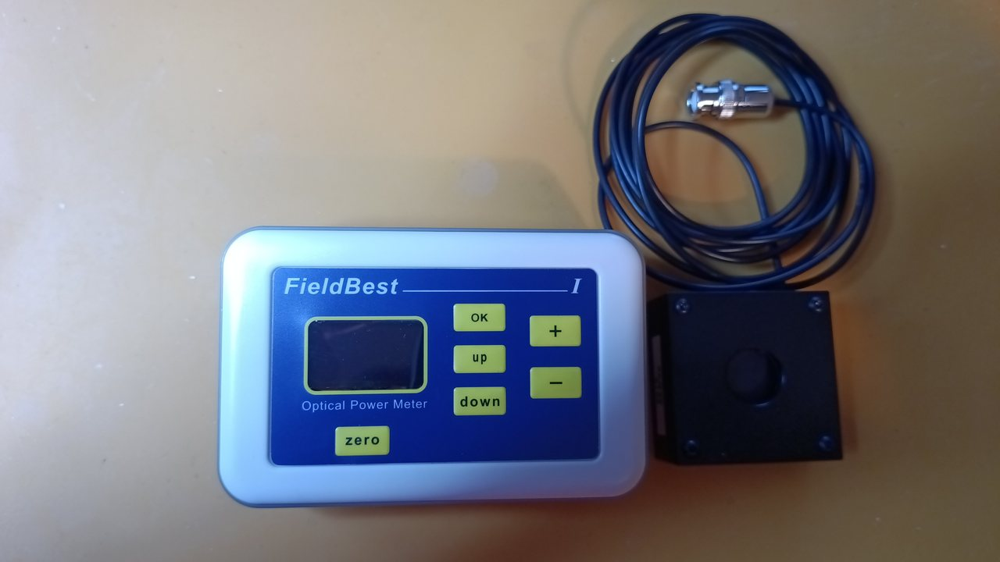
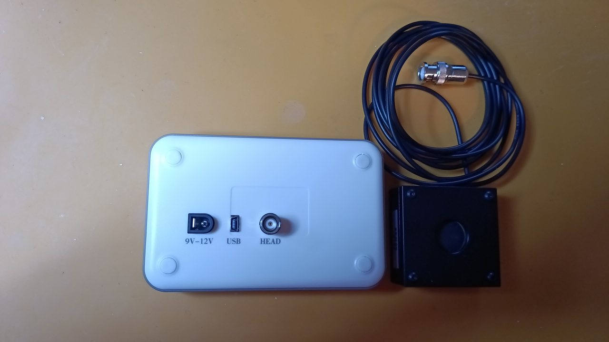
</p>

A display unit with an OLED and six buttons (zero, down, up, OK, −, +), and a
separate head on a cable with a BNC plug. The head is labelled **50 W / 10 mW**
(range) with a build code. A second label on the head says
注意10W以上 须外加散热处理, which means "Note: above 10 W, additional heat sinking
is required". Without a heat sink the head is only meant for continuous use up to about 10 W.

<p>
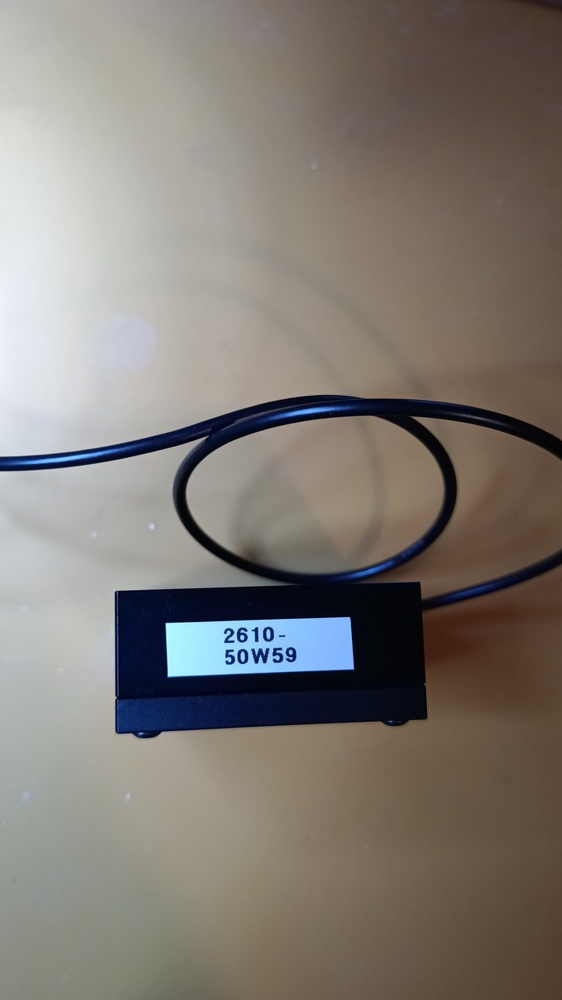
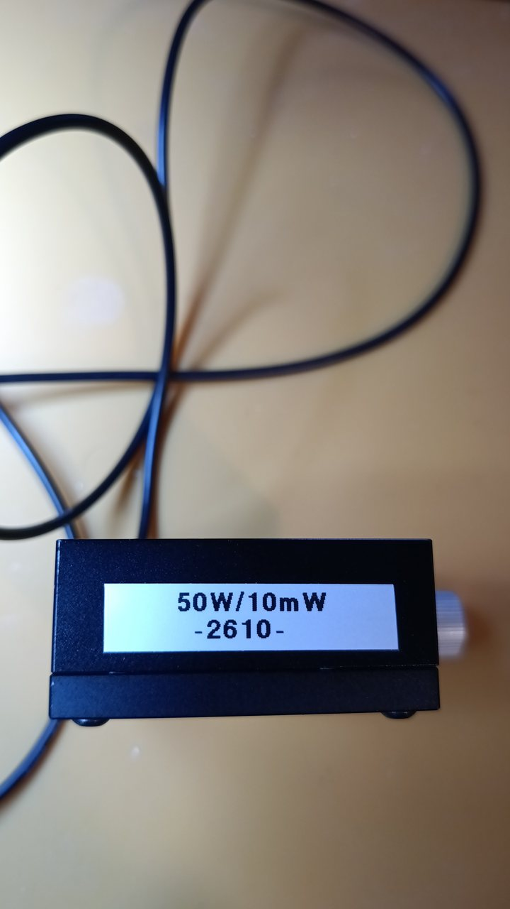
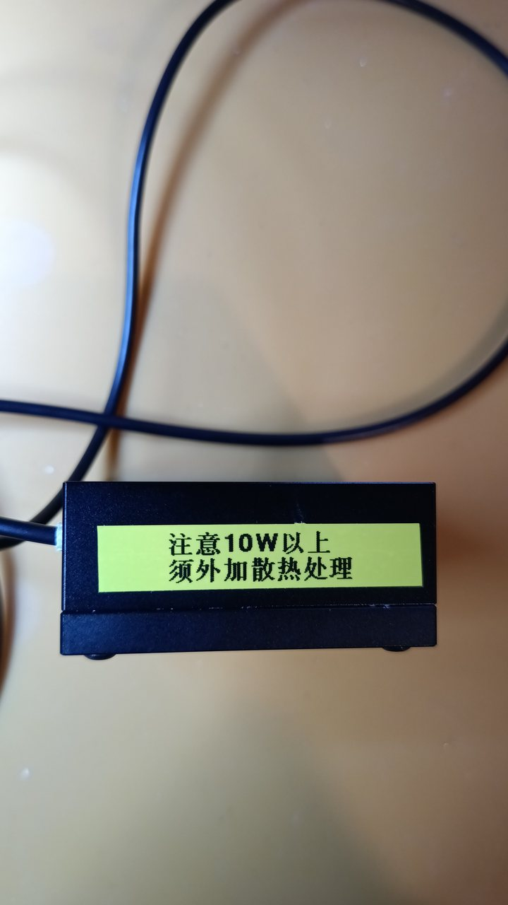
</p>

## Connecting

The meter has a mini-USB socket at the back. It does not power the meter, which
needs its own supply. The head plugs into a BNC socket.

| | |
|---|---|
| Supply | 9–12 V DC per the rear label (the manual says 9–15 V), 5.5/2.1 mm barrel, centre positive, 9 V adapter included |
| Head | BNC socket, 2-wire signal from the thermopile disc |
| Supply current | 49 mA at 10 V (≈ 0.5 W), measured while it was logging over USB |
| USB ID | `0483:5740` (STM32 Virtual COM Port) |
| Windows 10/11 | inbox driver, shows up as `COMx` |
| Linux | `cdc_acm`, shows up as `/dev/ttyACM*` |
| Baud rate | ignored on USB, any value works |

The 9 V adapter that comes with the meter has a plug that does not fit EU
sockets. For all measurements here the meter was therefore powered from a lab
supply (EEZ BB3) set to **10 V with a 100 mA current limit**. It draws 49 mA, so
the supply stays in constant-voltage mode with plenty of headroom.

A Windows program for this device can be found on the Endurance Lasers FieldBest
page. It is not needed. It also requires the old `MSCOMM32.OCX` ActiveX control
to be registered, writes its data to `C:\temp.txt`, polls about once per second,
and records no time stamps. Its files are not included here.

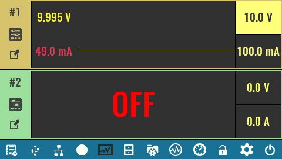

## Inside

<p>
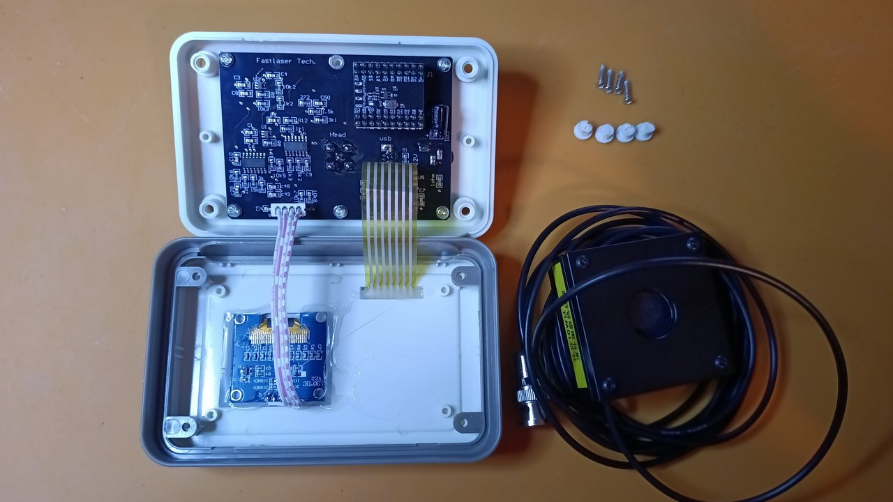
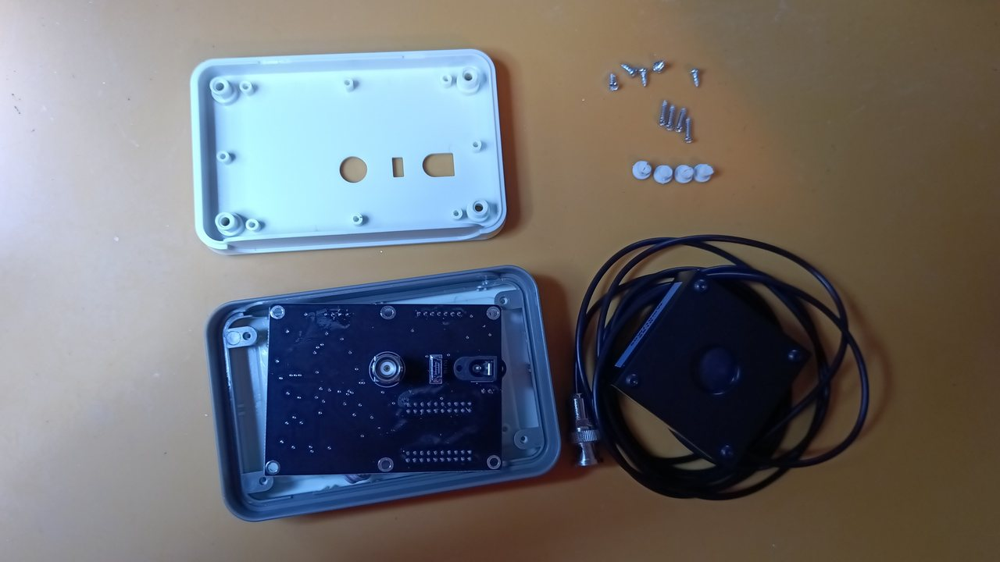
</p>

The main board is marked **"Fastlaser Tech."**, which is probably the actual maker
behind the "FieldBest" name.

- **MCU:** an **STM32F103C8T6** on a plug-in module with its own crystal, which
  explains the USB ID `0483:5740`. There is no separate ADC chip, so the
  conversion is presumably done by the STM32's internal 12-bit ADC.
- **Analog front end:**
  - two **CD4066BM** quad analog switches (TI) with a resistor network (1 k,
    5.1 k, 10 k). This is most likely the gain or range switching.
  - **U1**, a SOT-23-5 part marked `LTAEG`, which looks like a Linear Technology
    marking code. In this position it is most likely the low-offset preamp for the
    thermopile's µV signal. Not identified for certain.
- **Display:** a standard 0.96″ I²C OLED module (`oled+ G sck sda`).
- **Keypad:** a membrane keypad on a flat flex cable.

<p>
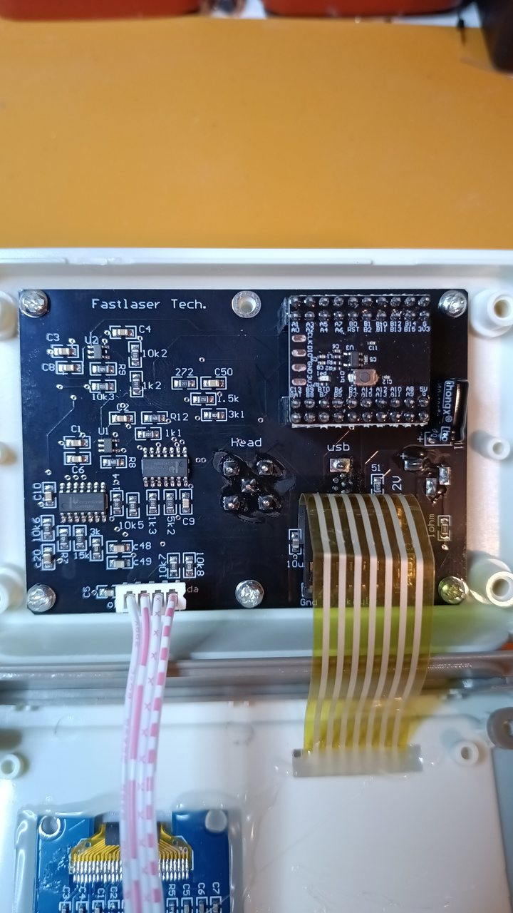
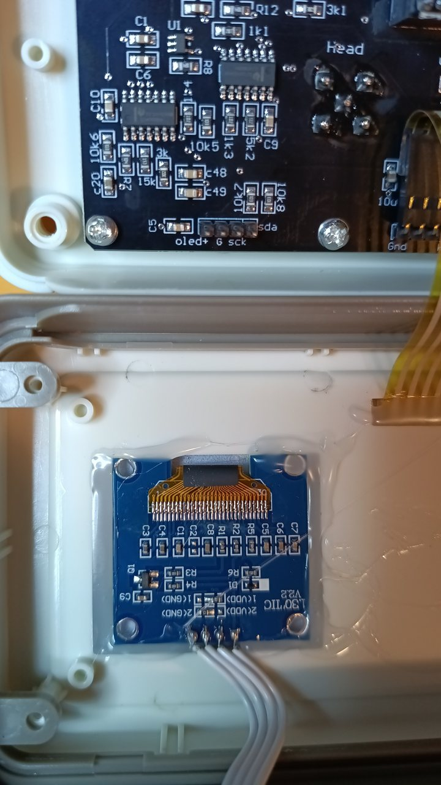
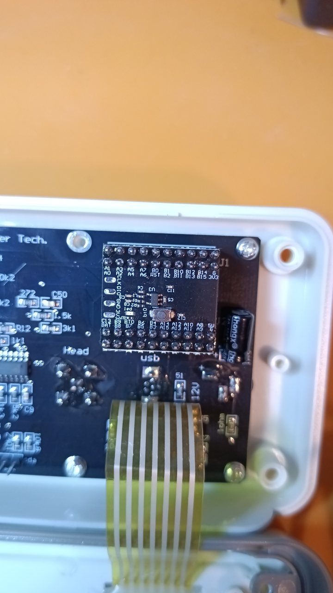
</p>
<p>
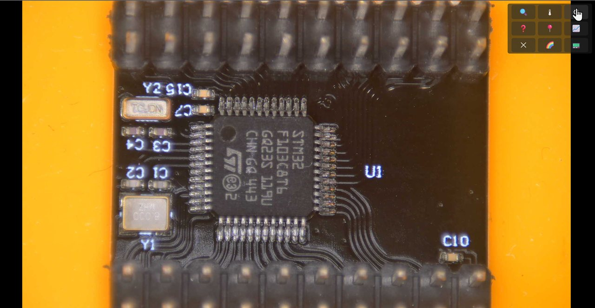
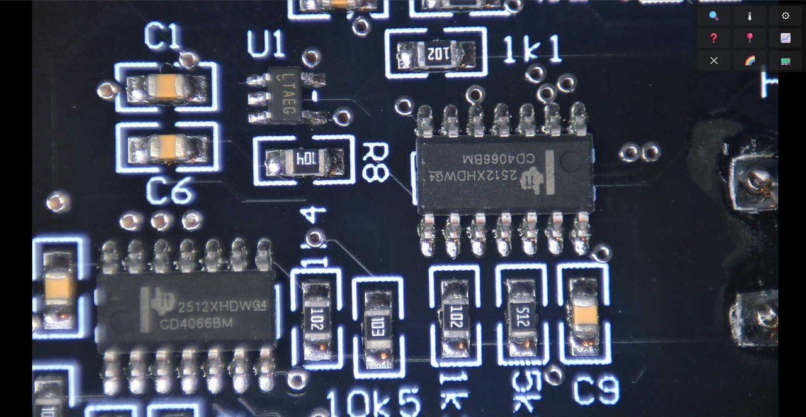
</p>
<p>
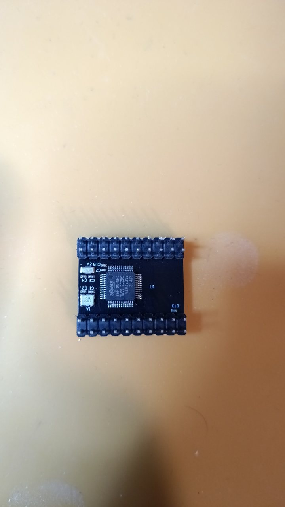
</p>

**The head.** With the front plate removed there is a round aluminium disc with
a black-coated centre. This is the classic radial **thermopile** layout: the
centre absorbs, and the thermocouples sit on the ring and measure the heat flowing
outward. It confirms the measured behaviour (CW response, ~10 s time constant)
and contradicts the "pyroelectric" wording in the manual. Do not touch the black
coating. The calibration depends on it.

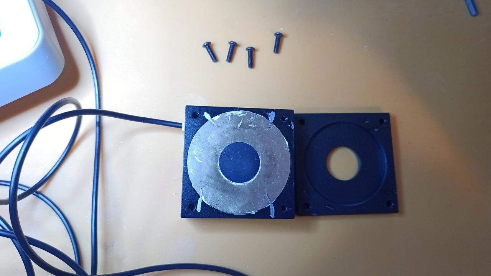

## Protocol

```
host  -> meter   ?pw%                (4 ASCII bytes, no line ending)
meter -> host    0.340\x00\n         (reading in watts, NUL + LF terminated)
```

Wait about 0.25 s for the reply. Polling every 0.5 s works reliably. Zeroing,
range and wavelength are set with the buttons on the meter.

## Tools

```bash
pip install pyserial
python tools/fieldbest.py                    # one reading, port auto-detected
python tools/fieldbest_log.py run.csv        # log time,watts every 0.5 s (Ctrl+C or STOP_FIELDBEST file ends it)
python tools/fieldbest_steps.py run.csv      # find laser-on steps, mean of the settled last 20 s
```

`tools/fieldbest.py` can also be imported (`FieldBest().read_watts()`).
`examples/galvo_power_steps.py` fires timed power steps on a BJJCZ/LMC galvo
controller (via galvoplotter) while the logger runs.

Tools are LLM assisted developed.

## How to measure

- Above about 10 W, mount the head on a heat sink. This is what its warning label says.
- Zero the meter with nothing in front of the head. Afterwards the readings sit within ±5 mW.
- Keep the whole beam inside the 18 mm aperture, and do not touch or heat the
  head housing.
- **Defocus pulsed lasers.** A focused ns spot can burn the absorber coating. A
  check at two different heights giving the same reading shows that the whole beam
  is captured.
- Let every step run **≥ 40 s** and evaluate the **last 20 s**. The reading needs
  about 10 s to reach 95 % of its final value.

## Validation

### Hand-held CW lasers

| Laser | Label | Reading |
|---|---|---|
| Grid-pattern laser module | 50 mW | 0.053 W |
| 505 nm dot module | 30 mW (35 mW diode) | ~0.045 W (hand-held) |

### 455 nm diode laser, 20 W (PWM), 5 mm circle, 100 mm/s

| Setting | 5 % | 10 % | 20 % | 30 % | 40 % | 50 % |
|---|---|---|---|---|---|---|
| Reading | 0 | 0 | 2.29 W | 4.83 W | 7.31 W | 9.86 W |

Every 10 % adds the same amount (2.54 / 2.48 / 2.55 W, within 1.7 %), with a
lasing threshold at about 11 %. Up to 50 % the reading reaches half of the 20 W
rating.

### 1064 nm fiber laser, 20 W, ns pulses at 30 kHz, defocused

| Setting | 1 % | 5 % | 10 % | 20 % | 30 % | 40 % | 50 % |
|---|---|---|---|---|---|---|---|
| Reading | 0 | 1.054 W | 2.395 W | 4.362 W | 6.474 W | 8.405 W | 10.615 W |
| Pulse energy | – | 35 µJ | 80 µJ | 145 µJ | 216 µJ | 280 µJ | 354 µJ |

A straight line through 10–50 % fits with R² = 0.9996 at 0.205 W per %, which
extrapolates to 20.5 W at 100 %. No point is more than 1.8 % off the line. Below
10 % the fiber laser's own curve bends, and 1 % does not lase at all. Within each
step the reading varies by less than 1 %, even at 10.6 W.

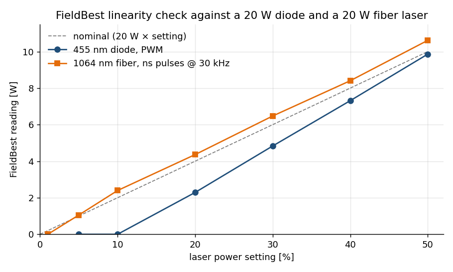

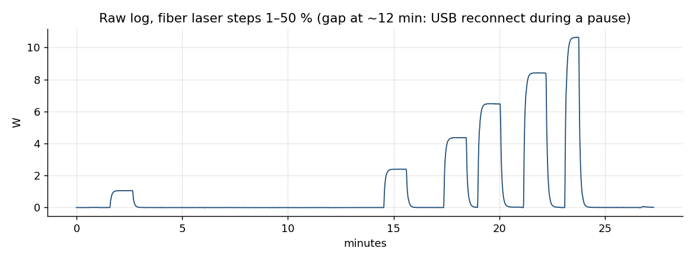

## License

The code is MIT licensed (see [`LICENSE`](LICENSE)). The charts and photos in
`media/` are [CC BY 4.0](https://creativecommons.org/licenses/by/4.0/).

> **Not affiliated with, endorsed by, or connected to any manufacturer or seller.**
> "FieldBest" and any other product names are trademarks of their respective owners
> and are used here only descriptively. Laser radiation is dangerous: wear goggles
> rated for the wavelength and never look into the beam or its reflections.
